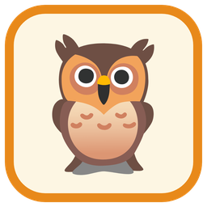
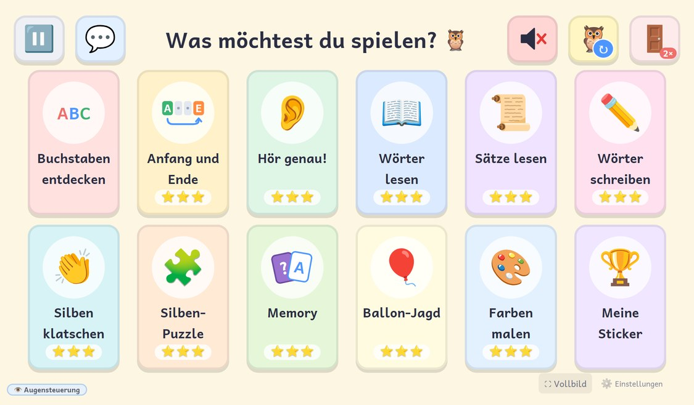
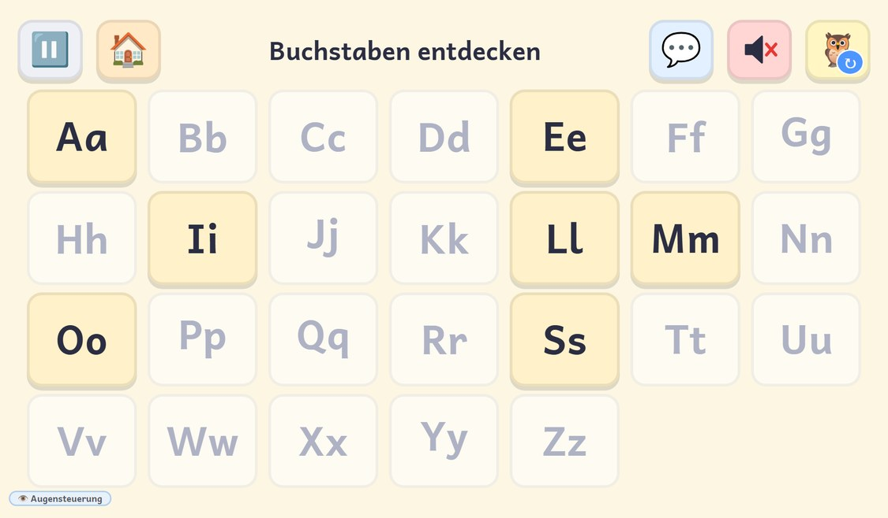
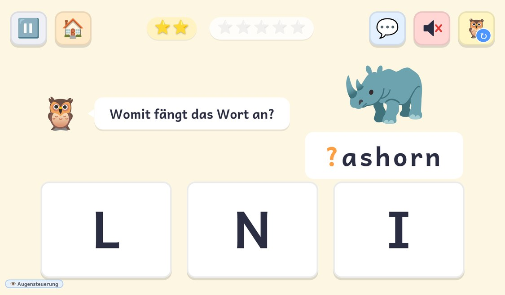
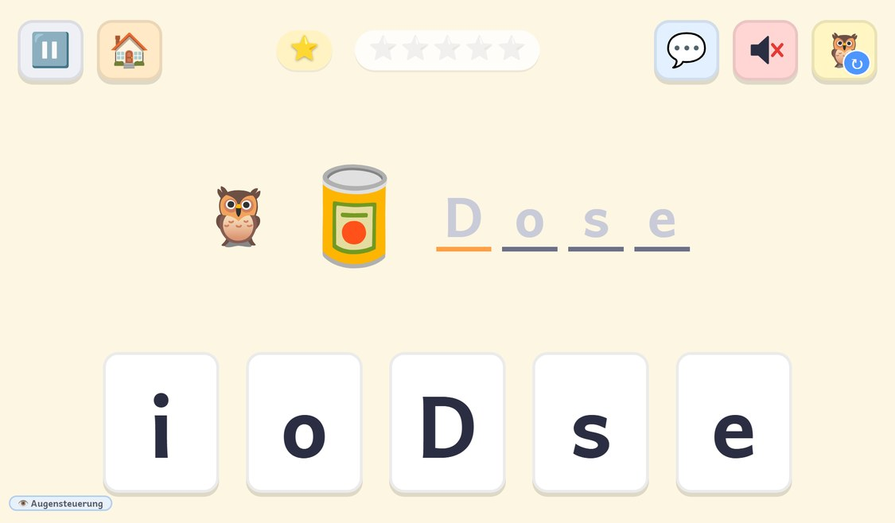
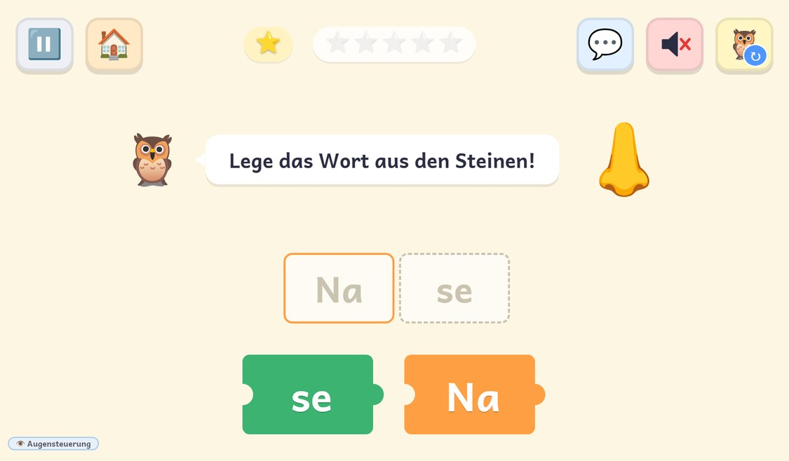
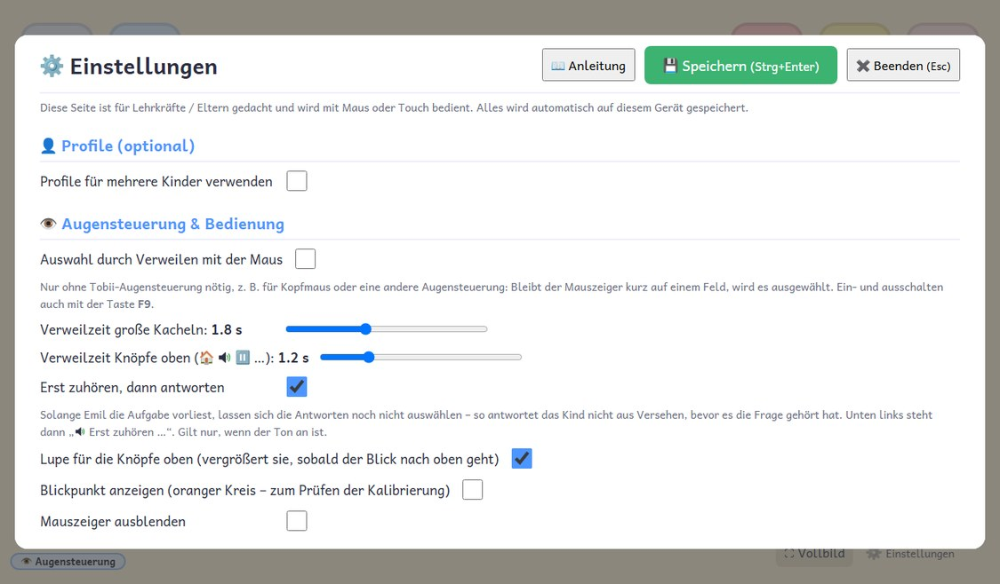

#  ABC-Abenteuer

**Spielerisch lesen und schreiben lernen – mit Augensteuerung, Maus oder Touch.**

ABC-Abenteuer ist ein kostenloses Lernprogramm für Kinder. Es wurde besonders mit Blick auf die Bedienung per Augensteuerung entwickelt, funktioniert aber genauso mit Maus und Touchscreen. Die Eule begleitet die Kinder durch die Übungen.

## ⬇️ ABC-Abenteuer 4.4 herunterladen

### [Jetzt ABC-Abenteuer 4.4 für Windows herunterladen](https://github.com/Natascha-Toman/ABC-Abenteuer/releases/tag/v4.4.0)

**Kostenlos · Für Windows · Keine klassische Installation erforderlich**

**So startest du das Programm:**

1. Lade die Windows-ZIP-Datei unter dem Link oben herunter.
2. Entpacke die ZIP-Datei vollständig.
3. Starte `ABC-Abenteuer.exe`.

> **Wichtig:** Lade unter „Assets“ die fertige Windows-ZIP-Datei herunter, nicht den automatisch angebotenen Quellcode („Source code“).

## 🎮 Was kann ABC-Abenteuer?

- **11 Lernspiele** rund um Buchstaben, Wörter, Sätze, Silben und Farben
- **Drei Schwierigkeitsstufen** zum schrittweisen Üben
- **Augensteuerung** mit einstellbarer Verweilzeit und großen Auswahlflächen
- **Natürliche Sprachausgabe**: Emil, die Eule, spricht Aufgaben, Rückmeldungen, Laute und Silben deutlich vor
- **Mitteil-Tafel** für eigene Aussagen während des Spielens
- **Kinderprofile** mit Lernfortschritt und Sticker-Album
- **Dunkler Hintergrund** auf Wunsch (blendet weniger)
- **Sichern und Wiederherstellen** der gespeicherten Daten
- **Offline nutzbar** – keine Internetverbindung erforderlich

## 📸 Einblicke ins Programm

### 🔤 Buchstaben entdecken
Buchstaben auswählen, kennenlernen und anhören.

### 🅰️ Anfang und Ende
Den Anfangsbuchstaben eines Wortes erkennen und auswählen – und den Endbuchstaben.

### ✏️ Wörter schreiben
Buchstaben in die richtige Reihenfolge bringen und Wörter zusammensetzen.

### 🧩 Silben-Puzzle
Aus einzelnen Silben Schritt für Schritt ganze Wörter bilden.

## 💬 Kommunikation bleibt möglich

Über die **Mitteil-Tafel** können Kinder auch während eines Spiels etwas mitteilen. Die Schaltflächen lassen sich mit eigenen Aussagen belegen und über die Sprachausgabe wiedergeben.

## 👀 Bedienung mit Augensteuerung

Bei der Augensteuerung wird eine Schaltfläche durch längeres Anschauen ausgewählt. Die Verweilzeit und weitere Bedienungshilfen lassen sich individuell einstellen. Eine Augensteuerung ist **nicht erforderlich**: Auch Maus und Touch funktionieren.

## 📝 Änderungen

Was sich in welcher Version geändert hat, steht im [Änderungsprotokoll (CHANGELOG.md)](CHANGELOG.md).

## 🔒 Datenschutz

ABC-Abenteuer funktioniert offline. Kinderprofile, Einstellungen und Lernfortschritte werden lokal auf dem verwendeten Computer gespeichert; das Programm überträgt diese Daten nicht an einen Server.

Weitere Informationen: [DATENSCHUTZ.md](DATENSCHUTZ.md)

## 💡 Hintergrund

ABC-Abenteuer ist eine Idee von **Natascha Toman**, die selbst Unterstützte Kommunikation und Augensteuerung nutzt. Ziel war ein Lernprogramm, das Kinder möglichst selbstständig bedienen können – unabhängig davon, ob sie ihre Augen, eine Maus oder einen Touchscreen verwenden.

*Idee, Konzeption und Umsetzung: Natascha Toman – entwickelt mit Unterstützung von KI.*

## 📄 Lizenz und Quellcode

Der eigene Quellcode steht unter der [MIT-Lizenz](LICENSE). Für verwendete Fremdkomponenten gelten deren jeweilige Lizenzbedingungen; siehe [THIRD-PARTY-LICENSES.md](THIRD-PARTY-LICENSES.md).
