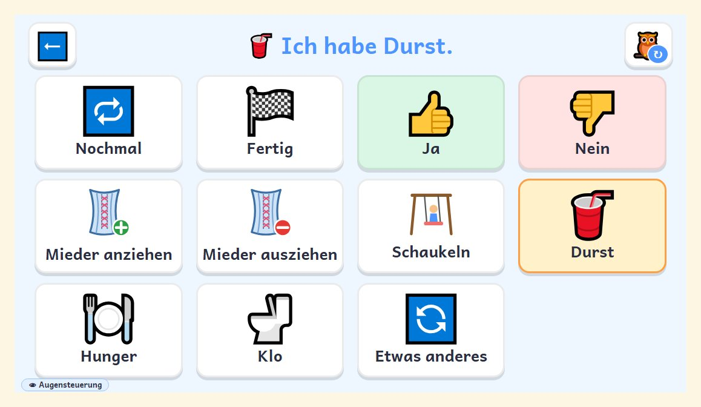

# 🦉 ABC-Abenteuer

**Spielerisch lesen und schreiben lernen – mit Augensteuerung, Maus oder Touch.**

ABC-Abenteuer ist ein kostenloses Lernprogramm für Kinder. Es wurde besonders mit Blick auf die Bedienung per Augensteuerung entwickelt, funktioniert aber genauso mit Maus und Touchscreen. Die Eule begleitet die Kinder durch die Übungen.

## 🎮 Was kann ABC-Abenteuer?

- **10 Lernspiele** rund um Buchstaben, Wörter, Sätze und Silben
- **Drei Schwierigkeitsstufen** zum schrittweisen Üben
- **Augensteuerung** mit einstellbarer Verweilzeit und großen Auswahlflächen
- **Sprachausgabe** für Aufgaben und Rückmeldungen
- **Mitteil-Tafel** für eigene Aussagen während des Spielens
- **Kinderprofile** mit Lernfortschritt und Sticker-Album
- **Sichern und Wiederherstellen** der gespeicherten Daten
- **Offline nutzbar** – keine Internetverbindung erforderlich

## 📸 Einblicke ins Programm

### 🔤 Buchstaben entdecken
Buchstaben auswählen, kennenlernen und anhören.

### 🍎 Womit fängt es an?
Den Anfangsbuchstaben eines Wortes erkennen und auswählen.

### ✏️ Wörter schreiben
Buchstaben in die richtige Reihenfolge bringen und Wörter zusammensetzen.

### 🧩 Silben-Puzzle
Aus einzelnen Silben Schritt für Schritt ganze Wörter bilden.

## 💬 Kommunikation bleibt möglich

Über die **Mitteil-Tafel** können Kinder auch während eines Spiels etwas mitteilen. Die Schaltflächen lassen sich mit eigenen Aussagen belegen und über die Sprachausgabe wiedergeben.

## 👀 Bedienung mit Augensteuerung

Bei der Augensteuerung wird eine Schaltfläche durch längeres Anschauen ausgewählt. Die Verweilzeit und weitere Bedienungshilfen lassen sich individuell einstellen. Eine Augensteuerung ist **nicht erforderlich**: Auch Maus und Touch funktionieren.

## ⬇️ Download für Windows

**[Zum Downloadbereich (Releases)](https://github.com/Natascha-Toman/ABC-Abenteuer/releases)**

Sobald eine Version zum Herunterladen bereitsteht:

1. Die ZIP-Datei unter **Releases** herunterladen.
2. Die ZIP-Datei vollständig entpacken.
3. Im entpackten Ordner `ABC-Abenteuer.exe` starten.

Eine klassische Installation ist nicht notwendig. Das Programm verwendet Microsoft WebView2; falls diese Komponente auf dem Windows-PC fehlt, muss sie gegebenenfalls nachinstalliert werden.

> **Hinweis:** Der Downloadbereich enthält erst dann eine fertige Programmversion, wenn ein Release veröffentlicht wurde. Der grüne **Code**-Button auf GitHub lädt dagegen den Quellcode herunter.

## 🔒 Datenschutz

ABC-Abenteuer funktioniert offline. Kinderprofile, Einstellungen und Lernfortschritte werden lokal auf dem verwendeten Computer gespeichert; das Programm überträgt diese Daten nicht an einen Server.

Weitere Informationen: [DATENSCHUTZ.md](DATENSCHUTZ.md)

## 💡 Hintergrund

ABC-Abenteuer ist eine Idee von **Natascha Toman**, die selbst Unterstützte Kommunikation und Augensteuerung nutzt. Ziel war ein Lernprogramm, das Kinder möglichst selbstständig bedienen können – unabhängig davon, ob sie ihre Augen, eine Maus oder einen Touchscreen verwenden.

*Idee, Konzeption und Umsetzung: Natascha Toman – entwickelt mit Unterstützung von KI.*

## 📄 Lizenz und Quellcode

Der eigene Quellcode steht unter der [MIT-Lizenz](LICENSE). Für verwendete Fremdkomponenten gelten deren jeweilige Lizenzbedingungen; siehe [THIRD-PARTY-LICENSES.md](THIRD-PARTY-LICENSES.md).
